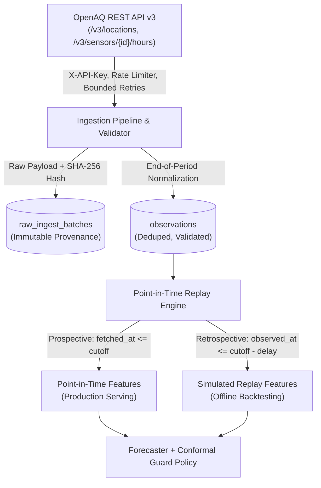

# SensorGuard AI — Architecture & Ingestion Design

## 1. System Overview

SensorGuard AI investigates whether forecast calibration can be preserved when environmental sensor networks experience nonrandom outages and delayed upstream reporting.

---

## 2. Ingestion & Provenance Architecture

### 2.1 Provider Client (`sensorguard.providers.OpenAQClient`)
- **Authentication**: Strict server-side `X-API-Key` header injection. Keys are never logged or exposed in client responses.
- **Rate Control**: Token bucket rate limiter (`RateLimiter`) enforcing bounded query rates.
- **Resilience**: Bounded exponential backoff with jitter on HTTP `429` (Too Many Requests) and `5xx` server errors. Respects upstream `Retry-After` header.
- **Auditability**: Calculates deterministic SHA-256 hashes of raw payloads prior to parsing.

### 2.2 Strict Timestamp Semantics
To prevent temporal contamination and future leakage, three distinct timestamps are tracked for every observation:
1. `observed_at`: The physical observation timestamp. In accordance with OpenAQ v3 hourly aggregate conventions, this corresponds to the **end of the measurement interval** (`period.datetimeTo` / `datetime.utc`).
2. `received_at`: The upstream provider publication/update timestamp. This is preserved **only if explicitly reported by upstream metadata**. If unavailable, it is stored as `NULL` (`None`). It is **never** inferred from `observed_at` or local system time.
3. `fetched_at`: The exact UTC timestamp when the SensorGuard worker fetched and stored the batch.

### 2.3 Idempotent Deduplication
The database enforces a unique constraint on `(sensor_id, observed_at)`. Duplicate records across repeated pagination or overlapping window fetches are safely deduplicated without data loss or exceptions.

---

## 3. Point-in-Time Historical Replay (`sensorguard.replay.PointInTimeReplayEngine`)

The replay engine provides two strictly separated execution modes:

| Mode | Filter Condition | Use Case | Guarantees |
| :--- | :--- | :--- | :--- |
| **Prospective Replay** | `Observation.fetched_at <= decision_cutoff` | Production backtesting & prospective auditing | Guarantees zero retroactive backfill leakage. Backfilled data fetched today cannot leak into historical predictions. |
| **Retrospective Replay** | `Observation.observed_at <= (decision_cutoff - delay_hours)` | Offline research backtesting where historical `fetched_at` was unrecorded | Explicitly flags outputs as `simulated_availability=True` with declared `assumed_delay_hours`. Never misrepresents simulated data as prospective truth. |

---

## 4. Storage & Relational Data Model

Supported storage backends:
- **Local Development / Testing**: SQLite (`sqlite:///data/sensorguard.db` or `:memory:`)
- **Production MLOps**: PostgreSQL (`postgresql://...` via `DATABASE_URL`)

### Relational Tables:
- `stations`: Physical monitoring location coordinates, country, timezone, and metadata.
- `sensors`: Individual instruments (e.g., PM2.5, units, averaging periods).
- `raw_ingest_batches`: Raw HTTP payload snapshots, response status, endpoint, parameters, and SHA-256 hashes.
- `observations`: Validated, normalized measurements with explicit timestamp lineage and quality flags (`HEALTHY`, `NO_REPORT`, `LATE`, `INVALID`).

Schema versioning is managed via **Alembic** migrations in `alembic/versions/`.
