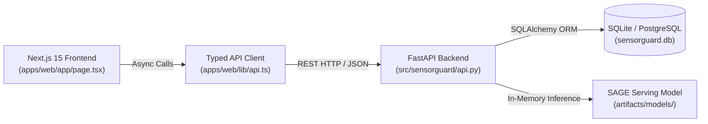

# SensorGuard AI — Frontend & API Contract Specification
**Milestone 5.2 Next.js 15 to FastAPI REST Interface**

- **Frontend Package:** `apps/web` (Next.js 15.3.9, React 19, Tailwind CSS)
- **API Client:** [apps/web/lib/api.ts](file:///c:/Users/Uma/Downloads/Project3/SensorGuard-AI/apps/web/lib/api.ts)
- **Backend Service:** [src/sensorguard/api.py](file:///c:/Users/Uma/Downloads/Project3/SensorGuard-AI/src/sensorguard/api.py) (FastAPI, Uvicorn, SQLAlchemy)
- **Base URL:** `http://127.0.0.1:8000` (configurable via `NEXT_PUBLIC_API_URL`)

---

## 1. System Architecture & Communication Flow



---

## 2. API Endpoints Specification

### 2.1 Health & Readiness Probes
- **`GET /health`**
  - **Purpose:** Kubernetes liveness probe.
  - **Response (200):** `{"status": "ok", "app": "SensorGuard AI", "version": "0.1.0"}`
- **`GET /health/ready` & `GET /api/v1/health/ready`**
  - **Purpose:** Readiness probe checking database connectivity and verified model serving availability.
  - **Response (200 / 503):**
    ```json
    {
      "status": "ready",
      "database_connected": true,
      "model_loaded": true,
      "model_version": "SAGE-LIGHTGBM-v1"
    }
    ```

### 2.2 Station Catalog & Geography
- **`GET /api/v1/stations`**
  - **Query Parameters:**
    - `bbox` (optional string): `"min_lon,min_lat,max_lon,max_lat"`
    - `is_active` (optional bool)
  - **Response (200):** `StationListResponse`
    ```json
    {
      "count": 8,
      "stations": [
        {
          "id": 1,
          "provider": "UK_AURN",
          "provider_location_id": "MY1",
          "name": "London Marylebone Road",
          "latitude": 51.5225,
          "longitude": -0.1546,
          "elevation": 35.0,
          "is_active": true,
          "sensors": [
            {
              "id": 1,
              "parameter": "pm25",
              "unit": "ug/m3",
              "is_active": true
            }
          ]
        }
      ]
    }
    ```

### 2.3 Station Observations Time Series
- **`GET /api/v1/stations/{station_id}/observations`**
  - **Query Parameters:**
    - `parameter` (default `"pm25"`)
    - `start_time` (optional ISO 8601 string)
    - `end_time` (optional ISO 8601 string)
    - `limit` (int, default `168`, max `1000`)
  - **Response (200):** `ObservationListResponse`
    ```json
    {
      "station_id": 1,
      "parameter": "pm25",
      "count": 24,
      "observations": [
        {
          "observed_at": "2024-03-31T23:00:00Z",
          "value": 14.2,
          "unit": "ug/m3",
          "flags": null
        }
      ]
    }
    ```

### 2.4 SAGE Guarded Forecasts
- **`GET /api/v1/stations/{station_id}/forecasts`**
  - **Query Parameters:**
    - `as_of` (optional ISO 8601 string, default latest observed timestamp)
    - `horizons` (int, default `24`)
  - **Response (200):** `ForecastListResponse`
    ```json
    {
      "station_id": 1,
      "generated_at": "2026-11-25T03:00:00Z",
      "forecasts": [
        {
          "target_at": "2024-04-01T00:00:00Z",
          "horizon_hours": 1,
          "point_forecast": 12.84,
          "lower_bound": 4.33,
          "upper_bound": 21.34,
          "published": true,
          "scenario_disagreement": 3.32,
          "abstention_reason": null
        }
      ]
    }
    ```
  - **Error States:**
    - `404 Not Found`: Station ID does not exist.
    - `503 Service Unavailable`: Model artifact missing, SHA-256 corrupted, or unmanifested.

### 2.5 Reliability Metrics
- **`GET /api/v1/stations/{station_id}/reliability`**
  - **Query Parameters:**
    - `window_hours` (int, default `168`)
  - **Response (200):**
    ```json
    {
      "station_id": 1,
      "window_hours": 168,
      "empirical_coverage": 0.9993,
      "target_coverage": 0.9,
      "mean_interval_width": 17.01,
      "abstention_rate": 0.0044,
      "published_forecasts_count": 2715,
      "abstained_forecasts_count": 12
    }
    ```

### 2.6 Cryptographic Model Status
- **`GET /api/v1/model/status`**
  - **Response (200):**
    ```json
    {
      "model_id": "sage_pilot_q1_2024",
      "version": "SAGE-LIGHTGBM-v1",
      "algorithm": "SAGE (Sensitivity-Aware Guarded Ensemble)",
      "created_at": "2026-11-25T02:40:00Z",
      "dataset_hash": "33805c42097fc86e",
      "nominal_coverage": 0.9,
      "sha256": "2a03cd292ffd1ea352934d2926e83e3f331652e5e68190c21265b9c250018add",
      "verified": true,
      "model_path": "artifacts/models/sage_pilot_q1_2024.joblib",
      "artifact_exists": true
    }
    ```

---

## 3. Frontend Implementation Details

### Station Coordinates & London Geographic Mapping
Real coordinates for all 8 London AURN pilot stations are mapped in [page.tsx](file:///c:/Users/Uma/Downloads/Project3/SensorGuard-AI/apps/web/app/page.tsx):
- `Bloomsbury`: (51.5223° N, -0.1259° W)
- `Marylebone Road`: (51.5225° N, -0.1546° W)
- `Westminster`: (51.4947° N, -0.1319° W)
- `Bexley`: (51.4660° N, 0.1486° E)
- `Eltham`: (51.4526° N, 0.0708° E)
- `Harlington`: (51.4888° N, -0.4416° W)
- `Haringey Priory Park`: (51.5841° N, -0.1256° W)
- `North Kensington`: (51.5211° N, -0.2135° W)

### Uncertainty Canvas Visualization
The forecast chart renders the conservative prediction interval envelope $[L_{\min}, U_{\max}]$ using dynamic SVG path shading (`rgba(59, 130, 246, 0.15)`), point predictions (solid line), and past observations (solid line), flagging points where $D_{\text{sensitivity}} > 8.0$ with red abstention markers.

### Explicit Demonstration Mode Toggle
If the backend is not running or the user requests offline demonstration, the dashboard provides a prominent amber banner:
`"⚠️ DEMO MODE ACTIVE — Using archived demonstration data (Backend offline or toggle enabled)"`
The toggle allows instant switching between live API query mode and local demonstration mode.
