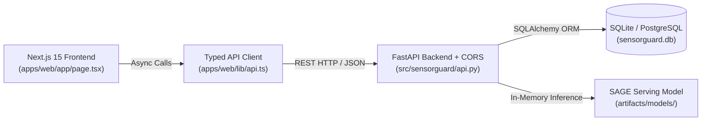

# SensorGuard AI — Frontend & API Contract Specification
**Milestone 5.3 Verified Next.js 15 to FastAPI REST Interface**

- **Frontend Package:** `apps/web` (Next.js 15.5.29, React 18.3, TypeScript, Tailwind CSS)
- **API Client:** [apps/web/lib/api.ts](file:///c:/Users/Uma/Downloads/Project3/SensorGuard-AI/apps/web/lib/api.ts)
- **Backend Service:** [src/sensorguard/api.py](file:///c:/Users/Uma/Downloads/Project3/SensorGuard-AI/src/sensorguard/api.py) & [src/sensorguard/schemas.py](file:///c:/Users/Uma/Downloads/Project3/SensorGuard-AI/src/sensorguard/schemas.py)
- **Base URL:** `http://localhost:8000` (configurable via `NEXT_PUBLIC_API_URL`)
- **CORS Configuration:** Explicit origins configured via `CORS_ORIGINS` (default: `http://localhost:3000,http://127.0.0.1:3000`)

---

## 1. System Architecture & Communication Flow



---

## 2. Verified API Endpoints Specification

### 2.1 Health & Readiness Probes
- **`GET /health` & `GET /healthz`**
  - **Response (`HealthResponse`, 200):**
    ```json
    {
      "status": "ok",
      "database_connected": true,
      "data_mode": "real_pilot",
      "stations_count": 8,
      "observations_count": 14556,
      "timestamp": "2026-11-25T04:00:00Z"
    }
    ```
- **`GET /health/ready` & `GET /api/v1/health/ready`**
  - **Response (`ReadinessResponse`, 200):**
    ```json
    {
      "status": "ready",
      "database_connected": true,
      "model_loaded": true,
      "model_version": "1.0.0"
    }
    ```

### 2.2 Station Catalog & Geography
- **`GET /api/v1/stations`**
  - **Query Parameters:** `bbox` (optional `"min_lon,min_lat,max_lon,max_lat"`)
  - **Response (`StationListResponse`, 200):**
    ```json
    {
      "stations": [
        {
          "id": 1,
          "provider": "openaq",
          "provider_location_id": 141,
          "name": "London Harlington - UKA00472",
          "latitude": 51.4888,
          "longitude": -0.4416,
          "country": "GB",
          "timezone_name": "Europe/London",
          "status": "HEALTHY",
          "is_stale": false,
          "is_archived_pilot": true,
          "latest_observation_time": "2024-03-31T23:00:00Z",
          "latest_pm25_value": 10.9,
          "age_hours": 0.0
        }
      ],
      "total_count": 8,
      "provider_citation": "OpenAQ v3 / UK AURN Network (Crown Copyright / OGL)"
    }
    ```

### 2.3 Station Observations Time Series
- **`GET /api/v1/stations/{station_id}/observations`**
  - **Query Parameters:**
    - `from` (optional ISO 8601 UTC start timestamp)
    - `to` (optional ISO 8601 UTC end timestamp)
    - `limit` (int, default `100`, min `1`, max `1000`)
  - **Response (`StationObservationsResponse`, 200):**
    ```json
    {
      "station_id": 1,
      "station_name": "London Harlington - UKA00472",
      "observations": [
        {
          "observed_at": "2024-03-31T23:00:00Z",
          "received_at": null,
          "fetched_at": "2026-11-22T12:00:00Z",
          "value": 10.9,
          "unit": "µg/m³",
          "quality_flag": "VALID",
          "source_status": "HEALTHY",
          "version": 1
        }
      ],
      "total_returned": 48,
      "latest_observed_at": "2024-03-31T23:00:00Z",
      "age_hours": 0.0,
      "freshness_status": "fresh",
      "provider_citation": "OpenAQ v3 / UK AURN Network (Crown Copyright / OGL)"
    }
    ```

### 2.4 SAGE Guarded Forecasts
- **`GET /api/v1/stations/{station_id}/forecasts`**
  - **Query Parameters:** `limit` (int, default `24`, min `1`, max `168`)
  - **Response (`StationForecastsResponse`, 200):**
    ```json
    {
      "station_id": 1,
      "station_name": "London Harlington - UKA00472",
      "current_status": "publish",
      "latest_forecast": {
        "station_id": 1,
        "decision_cutoff": "2024-03-31T23:00:00Z",
        "target_time": "2024-04-01T00:00:00Z",
        "point_forecast": 11.4,
        "lower_bound": 3.1,
        "upper_bound": 20.1,
        "nominal_coverage": 0.9,
        "model_version": "SAGE-LIGHTGBM-v1",
        "status": "publish",
        "abstain_reason": "sufficient_evidence",
        "is_stale": false,
        "scenario_bounds": [
          {"gamma": 0.0, "lower": 4.2, "upper": 17.5},
          {"gamma": 2.0, "lower": 3.1, "upper": 20.1}
        ],
        "feature_hash": null
      },
      "forecasts": ["..."],
      "provider_citation": "OpenAQ v3 / UK AURN Network"
    }
    ```
  - **Error States:** `404` if station missing; `503` if model artifact missing or SHA-256 verification fails.

### 2.5 Reliability Metrics & Research Experiments
- **`GET /api/v1/stations/{station_id}/reliability`**
  - Returns `StationReliabilityResponse`: `total_observations`, `first_observed_at`, `last_observed_at`, `gap_rate_pct`, `longest_consecutive_outage_hours`, `status_distribution`, and `benchmark_metrics`.
- **`GET /api/v1/research/experiments`** & **`GET /api/v1/research/experiments/{experiment_id}`**
  - Returns catalog (`ExperimentListResponse`) and full audit metrics (`ExperimentDetailResponse`) with declared `research_caveats`.

### 2.6 Cryptographic Model Status
- **`GET /api/v1/model/status`**
  - **Response (`ModelStatusResponse`, 200):**
    ```json
    {
      "model_id": "sage_pilot_q1_2024",
      "version": "1.0.0",
      "algorithm": "SAGE-LIGHTGBM",
      "created_at": "2026-11-25T04:08:50Z",
      "dataset_hash": "33805c42097fc86e",
      "nominal_coverage": 0.9,
      "sha256": "e552ca09a37856f809f2dc6db9f8eabf291a6fd4103da92874ac440bd91e4115",
      "verified": true,
      "model_path": "artifacts/models/sage_pilot_q1_2024.joblib",
      "artifact_exists": true
    }
    ```

---

## 3. Frontend Visual & Integrity Behavior

- **UK AURN 8-Station Network Projection:** Covers latitudes `50.6°N–53.8°N` and longitudes `-2.6°W–1.4°E`, accurately rendering London Harlington, London Hillingdon, Westminster Marylebone Road, Bexley Slade Green, Southampton Centre, Wicken Fen, St Osyth, and Manchester Piccadilly.
- **Timestamp-Aligned Chart Without Gap Fabrication:** Observed values are joined strictly to forecast timestamps by UTC hour (`YYYY-MM-DDTHH`). Unobserved intervals leave gaps rather than substituting model predictions.
- **Interactive Simulator Lab:** Queries `/api/v1/research/experiments/{id}` dynamically across `natural`, `mcar_20`, `mnar_gamma_1.5`, and `burst_24h` regimes, clearly separating `NATURAL OBSERVED` vs `SIMULATED OUTAGE`.
- **Demonstration Mode Fallback:** Prominently displays an explicit fallback banner when backend connectivity is absent or manually toggled.
